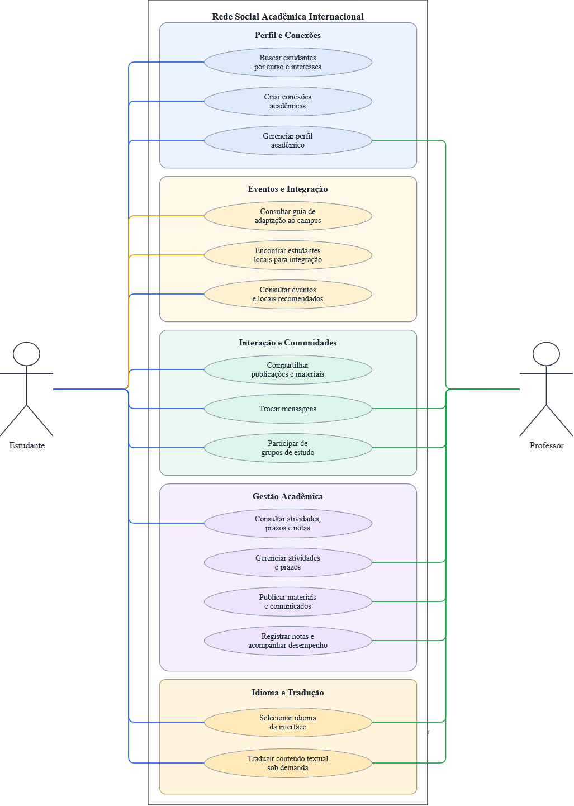
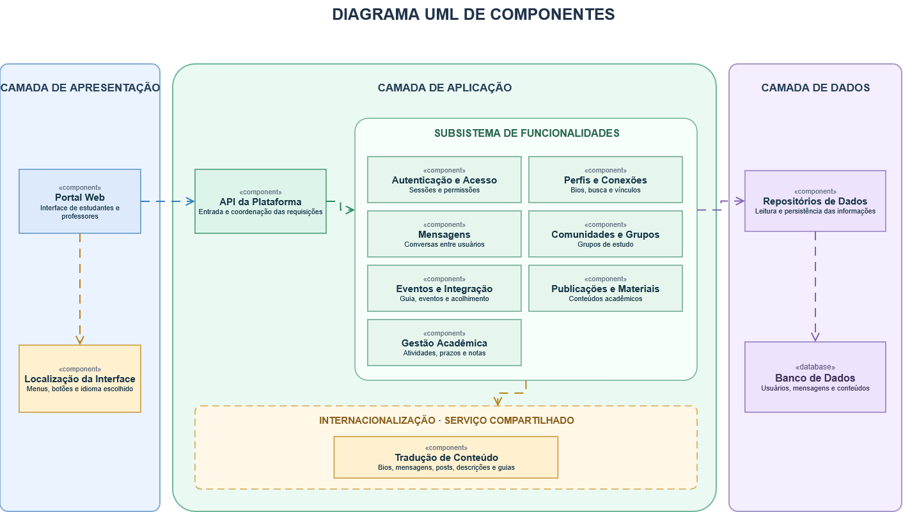
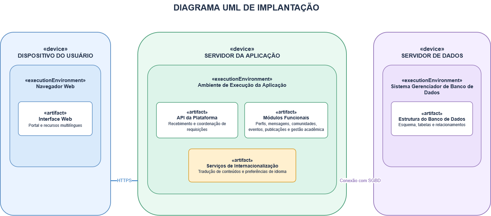

[README.md](https://github.com/user-attachments/files/34390401/README.md)
# Rede Social Acadêmica Internacional

**Conectando pessoas, culturas e conhecimento no ambiente universitário.**

> Projeto acadêmico do **Grupo 5**, desenvolvido na disciplina de **Engenharia de Requisitos**, com o tema *Sistema de Apoio à Internacionalização*.

## A proposta

Chegar a uma universidade em outro país envolve mais do que conhecer as salas de aula. É preciso encontrar pessoas, compreender a rotina acadêmica, descobrir oportunidades e superar barreiras de comunicação.

A **Rede Social Acadêmica Internacional** é uma proposta de plataforma web que aproxima **estudantes intercambistas, estudantes locais e professores** em um mesmo ambiente. O objetivo é facilitar a adaptação à universidade e incentivar conexões acadêmicas, colaboração e intercâmbio cultural.

## O que a plataforma propõe

| Área | Recursos previstos |
| --- | --- |
| **Conexões acadêmicas** | Perfis, busca por curso e interesses e conexões entre estudantes. |
| **Comunicação e colaboração** | Mensagens, publicações, compartilhamento de materiais e grupos de estudo. |
| **Integração ao campus** | Guias de adaptação, eventos e recomendações de locais e atividades. |
| **Acompanhamento acadêmico** | Consulta de atividades, prazos e notas, além de recursos de gestão para professores. |
| **Idiomas e tradução** | Seleção do idioma da interface e tradução de conteúdos textuais sob demanda. |

### Um espaço pensado para diferentes idiomas

A internacionalização está no centro da proposta. Além de permitir a escolha do idioma da interface, a plataforma prevê a tradução de mensagens, publicações e outros conteúdos textuais quando o usuário precisar. A intenção é reduzir barreiras linguísticas sem limitar a interação entre pessoas de diferentes países.

## Documentação do projeto

A especificação do sistema está organizada em documentos que descrevem sua visão, os públicos envolvidos, os requisitos, as regras de negócio e as prioridades de desenvolvimento.

| Documento | Conteúdo |
| --- | --- |
| [Documento de Visão](docs/documento-de-visao.md) | Problema, objetivos, público beneficiado e escopo da proposta. |
| [Stakeholders](docs/stakeholders.md) | Partes interessadas e sua relação com o sistema. |
| [Requisitos](docs/requisitos.md) | Requisitos funcionais e não funcionais da plataforma. |
| [Regras de Negócio](docs/regras-de-negocio.md) | Restrições e condições que orientam o comportamento do sistema. |
| [Backlog Inicial Priorizado](docs/backlog.md) | Funcionalidades organizadas por prioridade. |

## Modelagem UML

Os diagramas apresentam diferentes perspectivas do sistema. Os arquivos editáveis (`.drawio`) estão disponíveis na pasta [`diagramas-uml`](diagramas-uml/).

### Casos de uso

Representa as principais interações de estudantes e professores com a plataforma.

### Componentes

Apresenta a organização lógica dos módulos e suas relações.

### Implantação

Ilustra uma proposta de distribuição da aplicação entre cliente, servidor e banco de dados.

---
