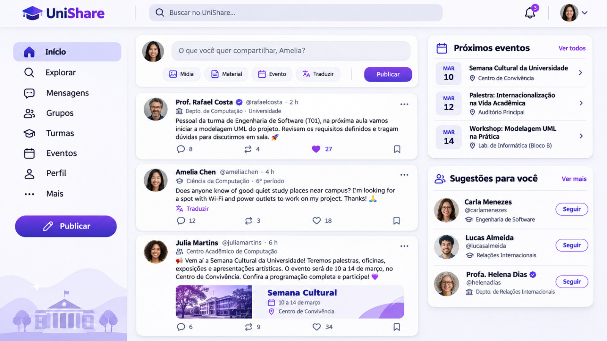

# UniShare — Rede Social Acadêmica Internacional

<p align="center"></p>

**Conectando pessoas. Compartilhando conhecimento.**

Projeto acadêmico do **Grupo 5**, curso de Análise e Desenvolvimento de Sistemas (ADS), Universidade de Fortaleza (Unifor), disciplina de Requisitos e Modelagem de Sistemas. Tema: Sistema de Apoio à Internacionalização.

## Sobre o projeto

Estudar em outro país exige conhecer pessoas, compreender a rotina universitária, encontrar informações de adaptação e superar barreiras linguísticas. O UniShare propõe uma rede social acadêmica que aproxima estudantes locais, intercambistas e professores em um ambiente de colaboração e integração cultural.

A proposta combina a dinâmica de comunicação do Twitter/X com a descoberta de pessoas e oportunidades do LinkedIn, acrescida de ferramentas de organização acadêmica e tradução sob demanda. A plataforma complementa, mas não substitui, sistemas acadêmicos oficiais.

<p align="center"></p>

*Proposta visual estática com dados ilustrativos; não é uma captura de aplicação em funcionamento.*

## Público e funcionalidades

Estudantes locais e intercambistas participam da rede, enquanto professores autorizados organizam suas turmas. Administradores atuam na governança da plataforma. Visitantes e candidatos a professor têm acesso condicionado ao seu papel.

| Módulo | Responsabilidade |
| --- | --- |
| M01 — Identidade e Perfis | Cadastro, autenticação, perfis e solicitação de autorização docente |
| M02 — Rede Social e Comunicação | Busca, conexões, mensagens, publicações e grupos de estudo |
| M03 — Integração Cultural e Descoberta | Guia de adaptação, locais, eventos e recomendações |
| M04 — Gestão Acadêmica | Turmas, materiais, atividades, entregas, notas internas e comunicados |
| M05 — Acessibilidade Linguística | Seleção do idioma e tradução textual sob demanda |
| M06 — Administração e Moderação | Acessos, autorização docente, catálogos, denúncias e exclusão |

## Documentação

| P1 — Elicitação e modelagem | P2 — Especificação e prototipação |
| --- | --- |
| [Visão da Demanda v4.1](docs/01-visao-demanda.md) | [SRS v1.1 — estrutura IEEE 830](docs/srs/SRS-UniShare-v1.1.md) |
| [Stakeholders](docs/02-stakeholders.md) | [Especificações dos 45 casos de uso](docs/casos-de-uso/README.md) |
| [Roteiro de entrevistas](docs/elicitacao/roteiro-entrevistas.md) | [Matriz de rastreabilidade](docs/validacao/matriz-rastreabilidade.md) |
| [Resultados de elicitação e situação das entrevistas](docs/elicitacao/resultados-entrevistas.md) | [Revisão de consistência](docs/validacao/revisao-consistencia.md) |
| [Requisitos funcionais](docs/requisitos/requisitos-funcionais.md) | [Registro de verificações](docs/validacao/verificacoes.md) |
| [Requisitos não funcionais](docs/requisitos/requisitos-nao-funcionais.md) | [Wireframes e mockups](prototipo/README.md) |
| [Regras de negócio](docs/requisitos/regras-de-negocio.md) | [Modelagem UML atualizada](diagramas-uml/README.md) |
| [Backlog priorizado](gestao/backlog.md) | [Acompanhamento P1/P2](gestao/entregas-p1-p2.md) |
| [Glossário](docs/requisitos/glossario.md) | — |

## Modelagem UML

| Diagrama | Visualização | Fonte editável |
| --- | --- | --- |
| Visão geral dos casos de uso | [SVG](diagramas-uml/casos-de-uso/visao-geral.svg) | [PlantUML](diagramas-uml/casos-de-uso/visao-geral.puml) |
| Casos de uso por módulo | [Índice dos seis módulos](diagramas-uml/README.md) | [Fontes](diagramas-uml/casos-de-uso/) |
| Hierarquia dos atores | [SVG](diagramas-uml/casos-de-uso/atores.svg) | [PlantUML](diagramas-uml/casos-de-uso/atores.puml) |
| Componentes | [SVG](diagramas-uml/componentes/componentes.svg) | [PlantUML](diagramas-uml/componentes/componentes.puml) |
| Implantação | [SVG](diagramas-uml/implantacao/implantacao.svg) | [PlantUML](diagramas-uml/implantacao/implantacao.puml) |

O contexto e os diagramas modulares complementam a visão geral. As imagens SVG são prévias; as fontes PlantUML representam a proposta UML editável.

## Prototipação

A [documentação visual](prototipo/README.md) reúne dez wireframes e dez mockups, associados aos casos de uso. A identidade visual utiliza azul e roxo, navegação lateral, feed central e perfis acadêmicos. As imagens não implementam fluxos; os elementos ilustrativos fora do escopo são registrados no índice de prototipação.

## Gestão do projeto

[Kanban](https://github.com/users/heitorrf/projects/1/views/1) · [Issues](https://github.com/heitorrf/requisitos-2026--grupo5/issues) · [Milestones](https://github.com/heitorrf/requisitos-2026--grupo5/milestones)

| Sprint | Marco | Foco |
| --- | --- | --- |
| 1 | M1 | Elicitação, requisitos e UML inicial |
| 2 | M2 | SRS, consistência e prototipação |
| 3 | M3 | Pitch final (fora deste pacote) |

A documentação P1/P2 está preparada para revisão. As entrevistas reais não foram comprovadas; o repositório contém roteiro e registro da limitação. O pacote apresenta prototipação estática, devendo ser confirmada com o professor a dispensa de navegação prevista no enunciado original. A situação efetiva das issues depende do GitHub Projects.

## Organização

```text
docs/            Visão, stakeholders, elicitação, requisitos, CDUs, SRS e validação
diagramas-uml/   Diagramas e fontes de modelagem
gestao/          Backlog e acompanhamento de entregas
prototipo/       Wireframes e mockups estáticos
```

## Referências

- [LAPIS — guia metodológico, templates e exemplos](https://github.com/marcelobezerra-dotcom/Lapis-unifor).
- Orientações P1 e P2 da disciplina (estrutura SRS solicitada: IEEE 830).
- Twitter/X e LinkedIn — referências conceituais de interação e interface, não integrações.

## Equipe

**Grupo 5 — ADS / Unifor.** A identificação nominal dos integrantes deve ser completada pelo grupo antes da entrega.
