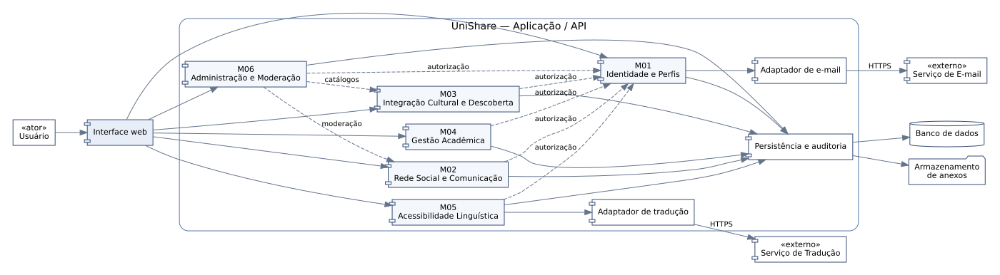
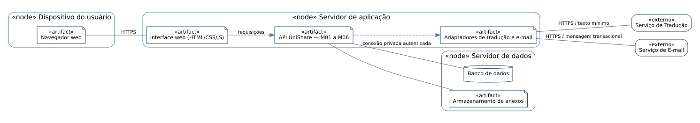

# Modelagem UML — UniShare

**Grupo 5 · Versão 1.0 · 25/11/2026**

> Proposta acadêmica para revisão; não representa validação por usuários reais.

## Casos de uso

A generalização define comportamentos compartilhados: atores concretos especializados herdam associações dos atores abstratos. Os recortes por módulo usam associações diretas do catálogo, sem `include`/`extend` não confirmados. Reticências ou ordem de desenho não representam ordem de execução. Os SVGs são prévias geradas a partir do mesmo catálogo com Graphviz (retângulos estereotipados para atores); os arquivos `.puml` são as fontes UML editáveis. Os `.dot` permitem regenerar as prévias.

- [Visão geral dos principais casos de uso](casos-de-uso/visao-geral.svg) ([PlantUML](casos-de-uso/visao-geral.puml)); síntese, não substitui os seis diagramas completos.
- [Contexto conceitual](casos-de-uso/contexto.svg)
- [Hierarquia de atores](casos-de-uso/atores.svg) ([PlantUML](casos-de-uso/atores.puml))

| Módulo | Imagem | Fonte UML |
| --- | --- | --- |
| M01 — Identidade e Perfis | [SVG](casos-de-uso/M01.svg) | [PlantUML](casos-de-uso/M01.puml) |
| M02 — Rede Social e Comunicação | [SVG](casos-de-uso/M02.svg) | [PlantUML](casos-de-uso/M02.puml) |
| M03 — Integração Cultural e Descoberta | [SVG](casos-de-uso/M03.svg) | [PlantUML](casos-de-uso/M03.puml) |
| M04 — Gestão Acadêmica | [SVG](casos-de-uso/M04.svg) | [PlantUML](casos-de-uso/M04.puml) |
| M05 — Acessibilidade Linguística | [SVG](casos-de-uso/M05.svg) | [PlantUML](casos-de-uso/M05.puml) |
| M06 — Administração e Moderação | [SVG](casos-de-uso/M06.svg) | [PlantUML](casos-de-uso/M06.puml) |

## Componentes

[PlantUML editável](componentes/componentes.puml). A interface consome a API, os módulos consultam identidade/autorização, os adaptadores encapsulam provedores externos e a persistência centraliza dados, anexos e auditoria. A solução é proposta; não foram definidos frameworks ou provedores de produção.

## Implantação

[PlantUML editável](implantacao/implantacao.puml). Dispositivo do usuário, servidor de aplicação e nó de dados são separados logicamente. Os serviços externos são acessados pelo servidor, nunca por credenciais expostas no navegador. HTTPS é requerido em produção. Os wireframes e mockups estáticos não representam uma implantação de produção.

[Visão](../docs/01-visao-demanda.md) · [SRS](../docs/srs/SRS-UniShare-v1.1.md)
