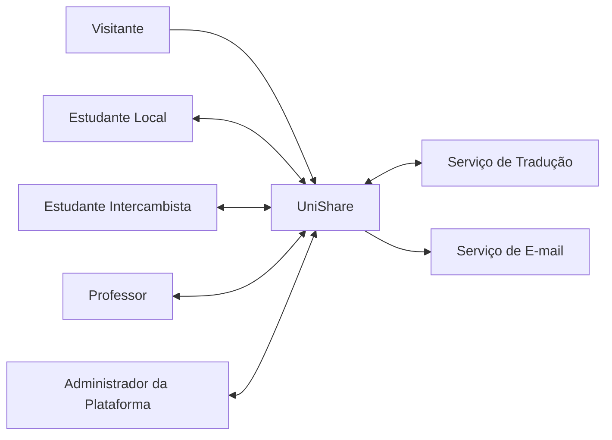
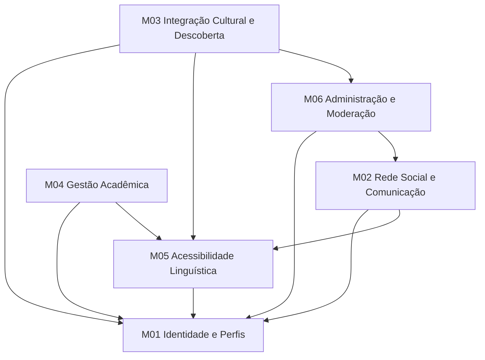
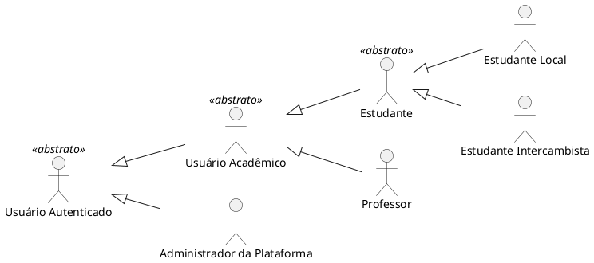
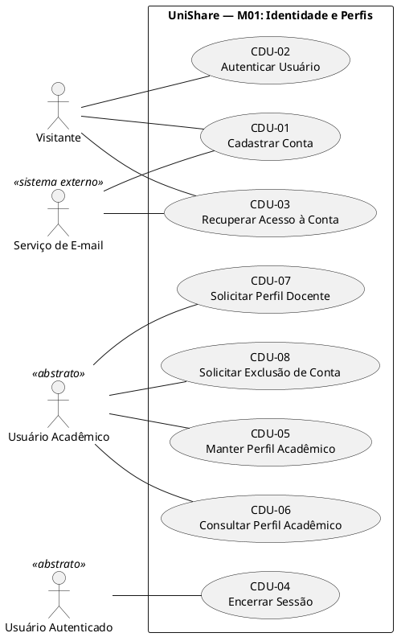
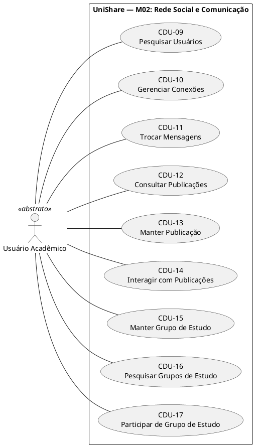
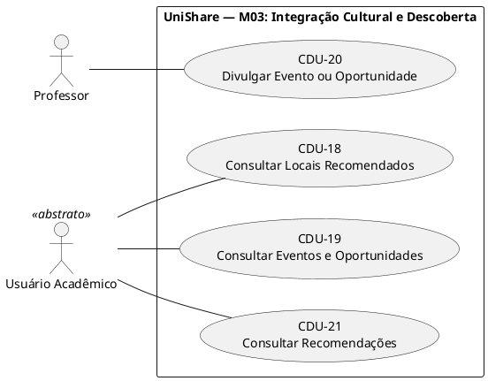
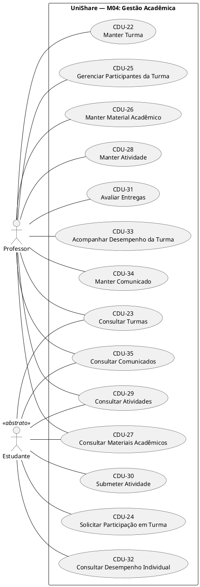
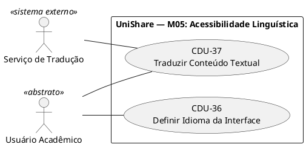
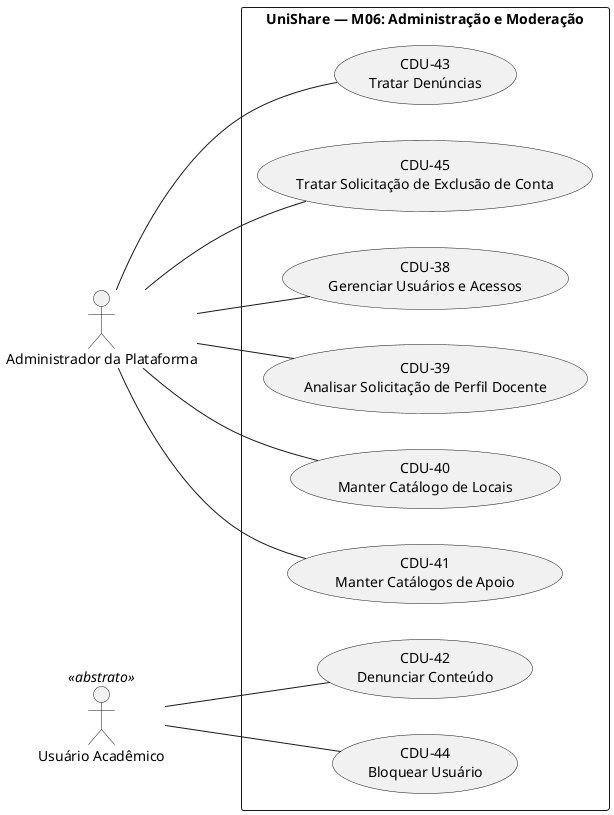

[01-visao-demanda-UniShare-v3.0.md](https://github.com/user-attachments/files/35429978/01-visao-demanda-UniShare-v3.0.md)

# Visão da Demanda (VD) — UniShare

<!-- Inserir a logomarca quando o arquivo estiver disponível:  -->

**UniShare — Rede Social Acadêmica Internacional**

> **Natureza:** projeto acadêmico do Grupo 5, desenvolvido na disciplina de Requisitos e Modelagem de Sistemas da Universidade de Fortaleza (Unifor). A proposta não constitui demanda institucional aprovada. O escopo, as prioridades e as regras registradas são propostas do projeto, sujeitas a validação.

## Identificação e Histórico

| Campo | Informação |
| --- | --- |
| Nome e identificador da demanda | UniShare — VD-UNISHARE-001 |
| Tipo | Novo sistema web |
| Sistema ou produto relacionado | Rede social acadêmica própria; sem integração institucional obrigatória |
| Área solicitante | Não definida — iniciativa acadêmica do Grupo 5 |
| Interlocutor de negócio | A definir; Grupo 5 responsável pela proposta inicial |
| Contato informado | Não informado |
| Responsável pela elaboração | Grupo 5 |
| Responsável pela aprovação formal | A definir; avaliação acadêmica pelo professor da disciplina |
| Situação | Visão revisada, aguardando validação |
| Versão e data | 3.0 — 25/11/2026 |

| Data | Versão | Descrição da alteração | Autor |
| --- | --- | --- | --- |
| 25/11/2026 | 1.0 | Consolidação inicial da visão | Grupo 5 |
| 25/11/2026 | 1.1 | Definição da identidade UniShare | Grupo 5 |
| 25/11/2026 | 2.0 | Estruturação conforme referência SINAIZ | Grupo 5 |
| 25/11/2026 | 3.0 | Revisão de atores, escopo, catálogo, regras, rastreabilidade e diagramas | Grupo 5 (proposta para revisão) |

## 1. Objetivo

Proporcionar um ambiente digital integrado para **estudantes intercambistas, estudantes locais e professores**, favorecendo a **integração social, cultural e acadêmica** dentro do contexto universitário.

A solução deverá permitir a criação de perfis acadêmicos, a formação de conexões entre usuários, a troca de mensagens, a participação em grupos de estudo, o compartilhamento de publicações e materiais acadêmicos, a consulta de eventos e locais relevantes e o acompanhamento de atividades acadêmicas em turmas mantidas na própria plataforma.

O sistema **não substitui sistemas acadêmicos institucionais oficiais** nem presume validade formal de notas, histórico ou matrícula fora do escopo da plataforma. Seu foco é integrar pessoas, experiências e conteúdos, apoiando a internacionalização e a colaboração universitária.

## 2. Contexto, Problema e Descrição Sumária da Demanda

### 2.1 Situação atual — entendimento inicial

- Estudantes intercambistas podem enfrentar dificuldades de adaptação ao campus, à rotina acadêmica e à comunicação com colegas e professores.
- Informações sobre **locais de estudo, pontos turísticos, eventos, espaços de convivência, atividades acadêmicas e recomendações úteis** costumam estar dispersas em grupos, redes sociais, canais institucionais e interações informais.
- Estudantes locais e professores também podem ter dificuldade para localizar pessoas com interesses compatíveis, divulgar oportunidades e estabelecer vínculos acadêmicos internacionais.
- Barreiras linguísticas podem reduzir a participação de usuários estrangeiros em atividades e interações cotidianas.
- Não foi apresentado, até o momento, um levantamento formal que comprove indicadores atuais de uso, volume de interações ou tempo gasto na busca dessas informações.

### 2.2 Problema ou oportunidade

A ausência de um espaço único voltado à **integração social e acadêmica internacional** pode dificultar a adaptação de intercambistas, a colaboração entre estudantes de diferentes nacionalidades e a comunicação entre professores e discentes em um contexto multicultural.

Ao mesmo tempo, existe a oportunidade de reunir, em uma única solução, recursos de **rede social**, **apoio à adaptação universitária**, **colaboração acadêmica** e **acessibilidade linguística**, fortalecendo a experiência universitária e a internacionalização.

### 2.3 Públicos afetados e impactos

Os principais públicos afetados são:

- **Estudantes intercambistas**, que poderão encontrar apoio para adaptação social, cultural e acadêmica;
- **Estudantes locais**, que poderão se conectar com colegas estrangeiros, participar de grupos e compartilhar experiências;
- **Professores**, que poderão organizar turmas, materiais, atividades e comunicação acadêmica em um ambiente mais acessível;
- **Instituições de ensino**, que podem se beneficiar indiretamente do fortalecimento da internacionalização e da cooperação acadêmica.

Impactos esperados: maior integração entre usuários, centralização de informações úteis, melhora na descoberta de conteúdos relevantes, redução de barreiras linguísticas e apoio à organização de atividades acadêmicas.

### 2.4 Evidências disponíveis

- Documento de Visão inicial elaborado pelo Grupo 5.
- Definição conceitual da proposta: rede social acadêmica voltada à integração entre intercambistas, estudantes locais e professores.
- Necessidades iniciais identificadas: comunicação, integração cultural, compartilhamento de materiais, organização acadêmica, recomendações e tradução.

**Limitação atual:** não foram fornecidos dados de entrevistas, questionários, métricas institucionais, validação com usuários reais ou aprovação formal de uma universidade demandante.

### 2.5 Descrição sumária

Disponibilizar uma plataforma web na qual usuários possam criar perfis acadêmicos, buscar pessoas por curso, área e interesses, estabelecer conexões, trocar mensagens, participar de grupos de estudo, compartilhar publicações e materiais, consultar eventos, pontos turísticos e locais recomendados, organizar turmas e atividades acadêmicas e traduzir conteúdos textuais sob demanda.

## 3. Proposta de Valor e Sucesso da Demanda

| Benefício esperado | Indicador ou evidência | Resultado desejado (proposta) | Como e quando avaliar |
| --- | --- | --- | --- |
| Facilitar a adaptação de intercambistas | Facilidade para localizar pessoas, locais e eventos úteis | Usuário encontrar apoio e informações relevantes na própria plataforma | Testes com cenários de uso e validação em protótipo |
| Incentivar a integração cultural | Conexões e interações entre estudantes locais e intercambistas | Estimular vínculos entre usuários com afinidades acadêmicas e culturais | Avaliação em piloto ou simulação de uso |
| Reduzir barreiras linguísticas | Capacidade de traduzir conteúdos essenciais | Permitir compreensão de mensagens, posts e descrições em idiomas diferentes | Testes funcionais com conteúdos em mais de um idioma |
| Melhorar a colaboração acadêmica | Compartilhamento de materiais, participação em grupos e turmas | Favorecer estudo conjunto, orientação e comunicação acadêmica | Testes com fluxos acadêmicos principais |
| Organizar atividades acadêmicas | Consulta de prazos, atividades e notas na plataforma | Centralizar acompanhamento das turmas cadastradas no sistema | Homologação dos fluxos com perfis de professor e estudante |
| Recomendar conteúdos relevantes | Adequação das recomendações a interesses e áreas | Sugerir livros, eventos e conteúdos alinhados ao perfil acadêmico | Validação por amostra com perfis distintos |

**Metas quantitativas de negócio:** a definir futuramente, após levantamento com usuários ou uso experimental. Nesta versão, o documento trabalha apenas com resultados desejados qualitativos.

## 4. Partes Interessadas

| Parte interessada | Papel e interesse | Responsabilidade | Representante |
| --- | --- | --- | --- |
| Estudantes locais | Integração e colaboração | Utilizar a rede e compartilhar experiências | A identificar |
| Estudantes intercambistas | Adaptação cultural e acadêmica | Utilizar a rede e contribuir com experiências | A identificar |
| Professores | Comunicação, ensino e cooperação | Gerenciar suas turmas, publicar materiais e oportunidades | A identificar |
| Instituições de ensino | Internacionalização e proteção de informações acadêmicas | Avaliar eventual adoção e autorizar uso de serviços institucionais | A definir |
| Administração da plataforma | Segurança, operação e convivência | Autorizar perfis privilegiados, manter catálogos e tratar denúncias | A definir |
| Provedor de tradução | Viabilizar tradução textual | Processar solicitações conforme contrato e privacidade | A selecionar |
| Provedor de e-mail | Viabilizar verificação e recuperação de conta | Entregar mensagens transacionais | A selecionar |
| Grupo 5 | Equipe da solução | Especificar, modelar e testar | Grupo 5 |
| Professor da disciplina | Orientação e avaliação acadêmica | Avaliar o artefato | Docente responsável |

Instituições são partes interessadas, não atores operacionais nesta versão. Não se presume contratação de fornecedores ou acesso a dados institucionais.

## 5. Usuários e Atores Externos

| ID | Ator | Tipo | Responsabilidade e acesso |
| --- | --- | --- | --- |
| AT-01 | Estudante Local | Humano, concreto | Utilizar recursos sociais e acadêmicos estudantis; orientar colegas |
| AT-02 | Estudante Intercambista | Humano, concreto | Utilizar recursos estudantis, inclusive apoio à adaptação e tradução |
| AT-03 | Professor | Humano, concreto | Utilizar recursos sociais e gerir turmas próprias, após autorização do perfil |
| AT-04 | Administrador da Plataforma | Humano, concreto | Administrar acessos, analisar solicitações de perfil docente, manter catálogos e moderar denúncias |
| AT-05 | Serviço de Tradução | Sistema externo, secundário | Retornar tradução solicitada; não inicia casos de uso |
| AT-06 | Visitante | Humano, concreto | Cadastrar conta, autenticar-se ou recuperar acesso sem sessão ativa |
| AT-07 | Usuário Acadêmico | Humano, abstrato | Generalizar funções comuns a estudantes e professores |
| AT-08 | Estudante | Humano, abstrato | Generalizar funções específicas dos dois perfis estudantis |
| AT-09 | Serviço de E-mail | Sistema externo, secundário | Entregar mensagens de confirmação e recuperação, se adotado |
| AT-10 | Usuário Autenticado | Humano, abstrato | Generalizar operações de sessão comuns a usuários acadêmicos e administradores |

**Generalização:** Estudante Local e Estudante Intercambista especializam Estudante; Estudante e Professor especializam Usuário Acadêmico; Usuário Acadêmico e Administrador da Plataforma especializam Usuário Autenticado. Os atores abstratos não são novos perfis de conta. Visitante representa a interação sem sessão ativa, inclusive de quem já possui conta.

O administrador não herda funções acadêmicas nem acesso irrestrito a dados privados. A classificação primário/secundário é determinada por caso de uso; os serviços externos são secundários nas interações previstas.

## 6. Necessidades e Catálogo de Funcionalidades

### 6.1 Necessidades

| ID | Necessidade | Atores relacionados |
| --- | --- | --- |
| NEC-01 | Identificar usuários e proteger o acesso às contas | AT-04, AT-06, AT-07, AT-09, AT-10 |
| NEC-02 | Encontrar pessoas e estabelecer conexões acadêmicas | AT-07 |
| NEC-03 | Comunicar-se e compartilhar experiências e conteúdos | AT-07 |
| NEC-04 | Organizar e participar de grupos de estudo | AT-07 |
| NEC-05 | Encontrar locais, pontos turísticos, eventos e oportunidades | AT-03, AT-04, AT-07 |
| NEC-06 | Descobrir conteúdos relevantes à área e interesses | AT-04, AT-07 |
| NEC-07 | Organizar turmas, materiais, atividades e comunicados | AT-03, AT-08 |
| NEC-08 | Acompanhar entregas, notas, prazos e desempenho | AT-03, AT-08 |
| NEC-09 | Reduzir barreiras linguísticas na interface e nos conteúdos | AT-05, AT-07 |
| NEC-10 | Garantir governança de perfis, catálogos e convivência | AT-04, AT-07 |

### 6.2 Funcionalidades

As prioridades são propostas: **Essencial** identifica a capacidade necessária para o escopo inicial completo de cada módulo; **Importante** identifica complementos previstos para evolução incremental. A implementação poderá ser dividida em entregas. Os casos de uso abaixo são identificados para especificação posterior; operações agrupadas de manutenção e interação deverão ter seus cenários explicitados nos fluxos.

| ID | Funcionalidade e resultado esperado | Necessidade | Atores | Prioridade | Especificação |
| --- | --- | --- | --- | --- | --- |
| F-01 | **Cadastrar Conta** — Criar conta acadêmica e confirmar endereço de e-mail | NEC-01 | AT-06, AT-09 | Essencial | CDU-01 |
| F-02 | **Autenticar Usuário** — Iniciar sessão com credenciais válidas | NEC-01 | AT-06 | Essencial | CDU-02 |
| F-03 | **Recuperar Acesso à Conta** — Restabelecer acesso mediante verificação segura | NEC-01 | AT-06, AT-09 | Essencial | CDU-03 |
| F-04 | **Encerrar Sessão** — Invalidar a sessão corrente | NEC-01 | AT-10 | Essencial | CDU-04 |
| F-05 | **Manter Perfil Acadêmico** — Consultar e alterar dados próprios, biografia, instituição, curso ou área, interesses e idiomas | NEC-01 | AT-07 | Essencial | CDU-05 |
| F-06 | **Consultar Perfil Acadêmico** — Visualizar dados de outro usuário conforme visibilidade | NEC-01 | AT-07 | Essencial | CDU-06 |
| F-07 | **Solicitar Perfil Docente** — Solicitar autorização para exercer funções docentes | NEC-10 | AT-07 | Essencial | CDU-07 |
| F-08 | **Solicitar Exclusão de Conta** — Solicitar encerramento da conta e tratamento dos dados conforme política aplicável | NEC-01 | AT-07 | Importante | CDU-08 |
| F-09 | **Pesquisar Usuários** — Filtrar pessoas por curso, instituição, área, interesses e idiomas | NEC-02 | AT-07 | Essencial | CDU-09 |
| F-10 | **Gerenciar Conexões** — Enviar, aceitar, recusar ou remover conexões | NEC-02 | AT-07 | Essencial | CDU-10 |
| F-11 | **Trocar Mensagens** — Enviar e consultar mensagens privadas entre participantes autorizados | NEC-03 | AT-07 | Essencial | CDU-11 |
| F-12 | **Consultar Publicações** — Visualizar feed e publicações acessíveis | NEC-03 | AT-07 | Essencial | CDU-12 |
| F-13 | **Manter Publicação** — Criar, editar e excluir publicações próprias, inclusive materiais e links | NEC-03 | AT-07 | Essencial | CDU-13 |
| F-14 | **Interagir com Publicações** — Comentar, reagir e salvar publicações acessíveis | NEC-03 | AT-07 | Importante | CDU-14 |
| F-15 | **Manter Grupo de Estudo** — Criar grupos e administrar dados e participantes quando responsável | NEC-04 | AT-07 | Essencial | CDU-15 |
| F-16 | **Pesquisar Grupos de Estudo** — Localizar grupos por tema ou área | NEC-04 | AT-07 | Essencial | CDU-16 |
| F-17 | **Participar de Grupo de Estudo** — Ingressar, sair e acessar conteúdos do grupo conforme permissões | NEC-04 | AT-07 | Essencial | CDU-17 |
| F-18 | **Consultar Locais Recomendados** — Consultar locais de estudo, convivência, serviços e pontos turísticos | NEC-05 | AT-07 | Essencial | CDU-18 |
| F-19 | **Consultar Eventos e Oportunidades** — Pesquisar palestras, workshops, congressos, vagas e oportunidades | NEC-05 | AT-07 | Essencial | CDU-19 |
| F-20 | **Divulgar Evento ou Oportunidade** — Cadastrar, atualizar e retirar divulgações próprias | NEC-05 | AT-03 | Essencial | CDU-20 |
| F-21 | **Consultar Recomendações** — Receber sugestões de livros, aulas, cursos, conteúdos e eventos por área e interesses | NEC-06 | AT-07 | Importante | CDU-21 |
| F-22 | **Manter Turma** — Criar, editar e encerrar turmas próprias | NEC-07 | AT-03 | Essencial | CDU-22 |
| F-23 | **Consultar Turmas** — Visualizar turmas acessíveis e respectivos dados | NEC-07 | AT-08, AT-03 | Essencial | CDU-23 |
| F-24 | **Solicitar Participação em Turma** — Solicitar ingresso em turma disponível ou por convite | NEC-07 | AT-08 | Essencial | CDU-24 |
| F-25 | **Gerenciar Participantes da Turma** — Autorizar ou recusar ingresso e gerenciar participantes de turmas próprias | NEC-07 | AT-03 | Essencial | CDU-25 |
| F-26 | **Manter Material Acadêmico** — Publicar, atualizar e retirar materiais de turmas próprias | NEC-07 | AT-03 | Essencial | CDU-26 |
| F-27 | **Consultar Materiais Acadêmicos** — Acessar materiais das turmas autorizadas | NEC-07 | AT-08, AT-03 | Essencial | CDU-27 |
| F-28 | **Manter Atividade** — Criar, atualizar e encerrar tarefas, exercícios e avaliações com prazo | NEC-07 | AT-03 | Essencial | CDU-28 |
| F-29 | **Consultar Atividades** — Acessar orientações, prazos e situação das atividades | NEC-07 | AT-08, AT-03 | Essencial | CDU-29 |
| F-30 | **Submeter Atividade** — Entregar trabalho e consultar situação de sua entrega | NEC-08 | AT-08 | Essencial | CDU-30 |
| F-31 | **Avaliar Entregas** — Consultar entregas de turmas próprias e registrar ou atualizar notas e feedback | NEC-08 | AT-03 | Essencial | CDU-31 |
| F-32 | **Consultar Desempenho Individual** — Acessar notas e feedback próprios | NEC-08 | AT-08 | Essencial | CDU-32 |
| F-33 | **Acompanhar Desempenho da Turma** — Consultar resultados individuais e coletivos de turmas próprias | NEC-08 | AT-03 | Importante | CDU-33 |
| F-34 | **Manter Comunicado** — Publicar, editar e retirar avisos de turmas próprias | NEC-07 | AT-03 | Essencial | CDU-34 |
| F-35 | **Consultar Comunicados** — Visualizar avisos das turmas autorizadas | NEC-07 | AT-08, AT-03 | Essencial | CDU-35 |
| F-36 | **Definir Idioma da Interface** — Selecionar idioma disponível e salvar preferência | NEC-09 | AT-07 | Essencial | CDU-36 |
| F-37 | **Traduzir Conteúdo Textual** — Solicitar tradução de mensagens, publicações, biografias, descrições e trechos textuais elegíveis | NEC-09 | AT-07, AT-05 | Essencial | CDU-37 |
| F-38 | **Gerenciar Usuários e Acessos** — Consultar contas e suspender ou restabelecer acesso conforme autorização | NEC-10 | AT-04 | Essencial | CDU-38 |
| F-39 | **Analisar Solicitação de Perfil Docente** — Autorizar ou recusar solicitação com base em critérios de verificação | NEC-10 | AT-04 | Essencial | CDU-39 |
| F-40 | **Manter Catálogo de Locais** — Cadastrar, atualizar e retirar locais recomendados | NEC-05 | AT-04 | Essencial | CDU-40 |
| F-41 | **Manter Catálogos de Apoio** — Manter áreas, interesses, categorias e referências de conteúdo para recomendações | NEC-06 | AT-04 | Importante | CDU-41 |
| F-42 | **Denunciar Conteúdo** — Registrar denúncia de conteúdo ou comportamento acessível ao denunciante | NEC-10 | AT-07 | Essencial | CDU-42 |
| F-43 | **Tratar Denúncias** — Analisar evidências autorizadas, registrar decisão e aplicar medidas cabíveis | NEC-10 | AT-04 | Essencial | CDU-43 |
| F-44 | **Bloquear Usuário** — Impedir novas interações diretas com usuário bloqueado e desfazer bloqueio | NEC-10 | AT-07 | Essencial | CDU-44 |
| F-45 | **Tratar Solicitação de Exclusão de Conta** — Executar ou encaminhar tratamento de dados conforme política de retenção | NEC-10 | AT-04 | Importante | CDU-45 |

### 6.3 Exemplos de consultas e interações para validação

- Encontrar estudantes locais e intercambistas com interesses em programação e idiomas em comum.
- Criar um grupo de estudo, localizar o grupo por área e solicitar participação.
- Consultar um ponto turístico e descobrir eventos acadêmicos relacionados ao curso.
- Solicitar perfil docente e verificar que a criação de turma é bloqueada até a autorização.
- Criar turma, autorizar ingresso, publicar material, criar atividade, receber entrega e disponibilizar nota; verificar que outro estudante não pode consultar essa nota.
- Traduzir uma mensagem em idioma suportado, mantendo o original disponível mesmo se o serviço falhar.
- Denunciar publicação e verificar que a administração pode tratar a denúncia sem acessar indiscriminadamente mensagens ou notas.

### 6.4 Regras de negócio e decisões de escopo propostas

| ID | Regra | Funcionalidades relacionadas |
| --- | --- | --- |
| RN-01 | A conta possui perfil estudantil ou docente; o perfil administrativo é concedido por procedimento restrito, não por cadastro público. | F-01, F-07, F-38, F-39 |
| RN-02 | A autorização docente depende de verificação; a forma de comprovação será definida antes da implantação. | F-07, F-39 |
| RN-03 | A conexão depende de aceitação do destinatário; bloqueio impede novas mensagens e solicitações diretas. | F-10, F-11, F-44 |
| RN-04 | Somente o autor pode editar ou excluir sua publicação; remoção por moderação é ação distinta e registrada. | F-13, F-43 |
| RN-05 | Grupos de estudo são espaços colaborativos; turmas são espaços acadêmicos geridos por professores autorizados. | F-15, F-17, F-22, F-25 |
| RN-06 | O ingresso em turma depende de autorização do professor responsável; o acesso aos materiais e atividades é restrito aos participantes autorizados. | F-23 a F-29, F-35 |
| RN-07 | Estudantes acessam apenas suas próprias entregas, notas e feedback; professores acessam os das turmas sob sua responsabilidade. | F-30 a F-33 |
| RN-08 | Notas do UniShare são internas e não equivalem a registros acadêmicos oficiais. | F-31 a F-33 |
| RN-09 | A tradução é solicitada pelo usuário, mantém o original e não altera o conteúdo armazenado; a falha não deve impedir acesso ao original. | F-37 |
| RN-10 | Recomendações consideram área e interesses informados; inteligência artificial avançada não é obrigatória. | F-21, F-41 |
| RN-11 | Professores mantêm suas divulgações; a administração mantém locais e catálogos de referência e atua sobre denúncias conforme política. | F-20, F-40, F-41, F-43 |
| RN-12 | O administrador não recebe acesso irrestrito a mensagens ou notas; ações administrativas sensíveis devem ser registradas. | F-38, F-39, F-43, F-45 |
| RN-13 | A verificação de e-mail não comprova vínculo acadêmico; recuperação e confirmação usam mecanismos temporários e seguros. | F-01, F-03, F-07 |
| RN-14 | A exclusão da conta deve observar retenção necessária, direitos de terceiros e tratamento de dados previsto na política aplicável. | F-08, F-45 |

As regras são propostas do grupo para detalhamento e validação, não políticas institucionais confirmadas. Tradução de arquivos integrais, imagens, áudio e vídeo não está prevista no escopo inicial; materiais podem oferecer texto ou descrição traduzível. Não há previsão de matrícula oficial, emissão de diplomas, pagamentos, chamadas de vídeo ou integração obrigatória com sistemas acadêmicos.

## 7. Visão Geral da Solução e Impactos

O UniShare reúne interação social, integração cultural, colaboração acadêmica e acessibilidade linguística em um ambiente web. A identidade e o controle de acesso são transversais. A tradução textual e o envio de e-mail são integrações externas propostas, sem fornecedor definido. O sistema deve continuar oferecendo acesso ao conteúdo original quando a tradução estiver indisponível.

### 7.1 Sistemas e processos impactados

| Sistema ou processo | Impacto | Situação |
| --- | --- | --- |
| Acolhimento de intercambistas | Apoio à adaptação e descoberta de pessoas e locais | Hipótese a validar |
| Comunicação e colaboração acadêmica | Centralização parcial de contatos e conteúdos | Hipótese a validar |
| Acompanhamento de turmas | Organização de atividades e notas internas | Sem integração oficial obrigatória |
| Serviço de tradução | Processamento de textos elegíveis | Fornecedor e privacidade a avaliar |
| Serviço de e-mail | Confirmação e recuperação de acesso | Fornecedor a avaliar |

### 7.2 Representação de contexto — conceitual

### 7.3 Decomposição funcional em módulos

| ID | Módulo | Objetivo | Casos de uso |
| --- | --- | --- | --- |
| M01 | Identidade e Perfis | Identificar usuários, controlar sessões e manter perfis | CDU-01, CDU-02, CDU-03, CDU-04, CDU-05, CDU-06, CDU-07, CDU-08 |
| M02 | Rede Social e Comunicação | Apoiar conexões, mensagens, publicações e grupos | CDU-09, CDU-10, CDU-11, CDU-12, CDU-13, CDU-14, CDU-15, CDU-16, CDU-17 |
| M03 | Integração Cultural e Descoberta | Facilitar descoberta de locais, eventos e conteúdos | CDU-18, CDU-19, CDU-20, CDU-21 |
| M04 | Gestão Acadêmica | Organizar turmas e acompanhar atividades e resultados | CDU-22, CDU-23, CDU-24, CDU-25, CDU-26, CDU-27, CDU-28, CDU-29, CDU-30, CDU-31, CDU-32, CDU-33, CDU-34, CDU-35 |
| M05 | Acessibilidade Linguística | Oferecer interface multilíngue e tradução textual | CDU-36, CDU-37 |
| M06 | Administração e Moderação | Controlar acessos privilegiados, catálogos e convivência | CDU-38, CDU-39, CDU-40, CDU-41, CDU-42, CDU-43, CDU-44, CDU-45 |

### 7.4 Mapa dos módulos e dependências

As setas representam dependências funcionais, não relações `include` ou `extend` entre casos de uso nem dependências técnicas entre componentes.

### 7.5 Diagramas de casos de uso por módulo

Os diagramas PlantUML representam recortes do mesmo sistema. As associações indicam participação, não ordem de execução. Os atores abstratos concentram comportamentos comuns. As relações `include` e `extend` serão avaliadas somente após detalhamento dos fluxos. A hierarquia completa é apresentada a seguir; os diagramas modulares usam apenas os atores diretamente associados.

#### 7.5.1 M01 — Identidade e Perfis

#### 7.5.2 M02 — Rede Social e Comunicação

#### 7.5.3 M03 — Integração Cultural e Descoberta

#### 7.5.4 M04 — Gestão Acadêmica

#### 7.5.5 M05 — Acessibilidade Linguística

#### 7.5.6 M06 — Administração e Moderação

### 7.6 Orientações para a modelagem

Os nomes e IDs do catálogo devem ser preservados na especificação. Cada caso de uso terá um objetivo principal, atores primários e secundários quando aplicável, pré-condições pertinentes, fluxos principal e alternativos, pós-condições e regras relacionadas. Operações agrupadas serão detalhadas em cenários próprios ou separadas caso o objetivo se mostre distinto. Autenticação e autorização são condições transversais; não devem ser modeladas como inclusão automática em todos os casos de uso. Os diagramas de componentes e implantação deverão respeitar a mesma fronteira do sistema.

## 8. Condições Gerais da Demanda

| Tipo | Condição |
| --- | --- |
| Escopo inicial | Rede social web acadêmica, integração cultural, tradução e gestão interna de turmas |
| Público | Estudantes locais, intercambistas e professores; administração operacional restrita |
| Acesso | Autenticação, autorização por perfil e por vínculo com turma; visitantes apenas em fluxos públicos de acesso |
| Privacidade | Minimizar dados pessoais; limitar visibilidade de perfis, mensagens, entregas e notas; avaliar retenção e exclusão |
| Moderação | Denúncias, bloqueio de usuários e decisões administrativas rastreáveis |
| Idiomas | Português e inglês como proposta inicial; outros idiomas dependem de validação e suporte |
| Tradução | Sob demanda, textos elegíveis, preservação do original; fornecedor a confirmar |
| E-mail | Envio transacional para confirmação e recuperação; mecanismo e fornecedor a confirmar |
| Conteúdo | Links e arquivos permitidos conforme formatos, limites e direitos de compartilhamento a definir |
| Acessibilidade | Interface utilizável em navegadores e dispositivos usuais; critérios verificáveis no RNF |
| Integrações | Sem acesso obrigatório a registros institucionais ou serviços de terceiros além das integrações propostas |
| Fora do escopo inicial | Matrícula oficial, histórico escolar oficial, pagamentos, tradução multimídia, videoconferência e aplicativo móvel nativo |

## 9. Riscos e Questões em Aberto

| ID | Situação | Questão / decisão | Próxima ação e responsável |
| --- | --- | --- | --- |
| PQ-01 | Aberta — negócio | Definir público inicial, instituições participantes e formas de validar a proposta | Grupo 5 e representantes de usuários |
| PQ-02 | Aberta — segurança | Definir comprovação de vínculo docente e critérios de autorização administrativa | Grupo 5; responsável operacional a definir |
| PQ-03 | Parcial — negócio | Definir grupos públicos/restritos, convites, regras de ingresso e saída de turmas | Grupo 5; detalhar CDUs |
| PQ-04 | Aberta — técnica | Selecionar serviço de tradução, verificar idiomas, custo, limites e tratamento de dados | Equipe técnica |
| PQ-05 | Aberta — técnica | Escolher serviço de e-mail e validar confirmação e recuperação de acesso | Equipe técnica |
| PQ-06 | Aberta — conteúdo | Definir fontes e atualização de locais, pontos turísticos e recomendações | Grupo 5 e administração |
| PQ-07 | Parcial — negócio | Notas internas; definir escalas, entregas atrasadas, revisão de notas e encerramento de turmas | Grupo 5 e professores |
| PQ-08 | Aberta — privacidade | Definir visibilidade, retenção, exclusão, compartilhamento com fornecedores e conformidade aplicável | Responsável pela plataforma, com apoio especializado quando necessário |
| PQ-09 | Aberta — moderação | Definir critérios, tratamento de evidências, medidas, recurso e responsabilidades | Grupo 5 e administração |
| PQ-10 | Aberta — técnica | Definir formatos, limites de armazenamento e critérios de qualidade | Equipe técnica; RNF |
| PQ-11 | Aberta — planejamento | Validar prioridades e dividir implementação em entregas viáveis | Grupo 5 |
| PQ-12 | Adiada — evolução | Integrações oficiais, aplicativo móvel e tradução multimídia | Reavaliar em versão futura |

O registro das decisões propostas não equivale à aprovação por usuários ou instituições.

## 10. Documentos Relacionados

| Documento | Conteúdo sob sua responsabilidade | Referência e situação |
| --- | --- | --- |
| Documento de Visão inicial | Proposta original e necessidades iniciais | Grupo 5; insumo desta revisão |
| Especificação de Casos de Uso | Detalhamento dos CDUs e critérios de aceitação | A conciliar com o catálogo v3.0 |
| Especificação de Requisitos Não Funcionais | Qualidade, segurança, privacidade, acessibilidade e limites técnicos | A revisar ou elaborar |
| Glossário | Termos acadêmicos e conceitos do domínio | A revisar ou elaborar |
| Backlog e Kanban | Priorização e planejamento incremental | A atualizar conforme versão 3.0 |
| Diagramas de Componentes e Implantação | Arquitetura e distribuição física | Conciliar com artefatos existentes do grupo |
| Referência LAPIS — Visão da Demanda SINAIZ | Estrutura do artefato de visão | [SINAIZ v2.4](https://github.com/marcelobezerra-dotcom/Lapis-unifor/blob/main/Requisitos/Artefatos/Exemplos/SINAIZ/01-visao-demanda-SINAIZ-v2.4.md) |
| Referência LAPIS — Casos de Uso | Orientação de especificação e nomenclatura | [Documentando Requisitos com Caso de Uso](https://github.com/marcelobezerra-dotcom/Lapis-unifor/blob/main/Requisitos/Especifica%C3%A7%C3%A3o%20de%20Casos%20de%20Uso/Casos%20de%20Usos.md) |

## 11. Validação da Visão

### 11.1 Checklist

- [x] Objetivo, contexto, problema e evidências disponíveis identificados.
- [x] Benefícios e formas de avaliação propostos, sem metas quantitativas inventadas.
- [x] Stakeholders, atores, responsabilidades e limites de escopo definidos.
- [x] Necessidades, funcionalidades e casos de uso identificados e rastreáveis.
- [x] Contexto, módulos, diagramas e regras propostas registrados.
- [x] Riscos, dependências externas e pendências identificados.
- [ ] Escopo, prioridades e regras validados pelo Grupo 5.
- [ ] Validação com representantes dos públicos realizada.
- [ ] Viabilidade dos serviços externos e privacidade verificadas.
- [ ] Casos de uso detalhados e demais artefatos conciliados com a visão.

### 11.2 Critérios de conclusão e encaminhamento

A visão está estruturada para revisão acadêmica e serve como base para especificação. Sua validação depende da confirmação do escopo, dos atores, das prioridades e das premissas pelo grupo e, quando possível, pelos representantes dos usuários. O catálogo não constitui especificação detalhada nem autorização de implantação institucional.

### 11.3 Registro da validação

| Versão | Responsável e papel | Data | Condição da VD | Resultado e ressalvas |
| --- | --- | --- | --- | --- |
| 3.0 | Grupo 5 — equipe da solução | A definir | Pendente de revisão | Confirmar escopo, regras e prioridades |
| 3.0 | Professor da disciplina — avaliação acadêmica | A definir | Pendente | Avaliação não registrada |
