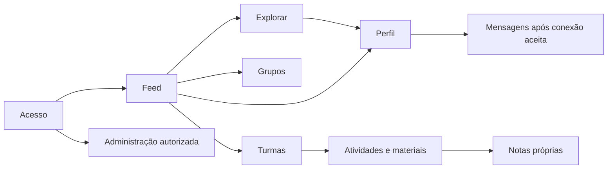

# Prototipação — UniShare

**Grupo 5 · Versão 1.1 · 25/11/2026**

## Finalidade

Representar visualmente a proposta de rede social acadêmica, inspirada no Twitter/X (feed, mensagens, navegação) e LinkedIn (perfis, conexões, descoberta de oportunidades), mantendo a identidade do UniShare. Os wireframes são esquemas de baixa fidelidade; os mockups são imagens conceituais de alta fidelidade, com dados fictícios. Nenhum deles é captura de uma aplicação em funcionamento.
## Índice de interfaces
| ID | Tela | Wireframe | Mockup | CDUs de referência |
| --- | --- | --- | --- | --- |
| IV-01 | Feed e publicações | [SVG](wireframes/01-feed.svg) | [PNG](mockups/feed.png) | [CDU-12](../docs/casos-de-uso/M02/CDU-12.md) · [CDU-13](../docs/casos-de-uso/M02/CDU-13.md) · [CDU-14](../docs/casos-de-uso/M02/CDU-14.md) · [CDU-37](../docs/casos-de-uso/M05/CDU-37.md) · [CDU-42](../docs/casos-de-uso/M06/CDU-42.md) |
| IV-02 | Explorar e descobrir | [SVG](wireframes/02-explorar.svg) | [PNG](mockups/explorar.png) | [CDU-09](../docs/casos-de-uso/M02/CDU-09.md) · [CDU-10](../docs/casos-de-uso/M02/CDU-10.md) · [CDU-16](../docs/casos-de-uso/M02/CDU-16.md) · [CDU-18](../docs/casos-de-uso/M03/CDU-18.md) · [CDU-19](../docs/casos-de-uso/M03/CDU-19.md) · [CDU-20](../docs/casos-de-uso/M03/CDU-20.md) · [CDU-21](../docs/casos-de-uso/M03/CDU-21.md) |
| IV-03 | Mensagens | [SVG](wireframes/03-mensagens.svg) | [PNG](mockups/mensagens.png) | [CDU-11](../docs/casos-de-uso/M02/CDU-11.md) · [CDU-37](../docs/casos-de-uso/M05/CDU-37.md) · [CDU-44](../docs/casos-de-uso/M06/CDU-44.md) |
| IV-04 | Grupos de estudo | [SVG](wireframes/04-grupos.svg) | [PNG](mockups/grupos.png) | [CDU-15](../docs/casos-de-uso/M02/CDU-15.md) · [CDU-16](../docs/casos-de-uso/M02/CDU-16.md) · [CDU-17](../docs/casos-de-uso/M02/CDU-17.md) |
| IV-05 | Turmas | [SVG](wireframes/05-turmas.svg) | [PNG](mockups/turmas.png) | [CDU-22](../docs/casos-de-uso/M04/CDU-22.md) · [CDU-23](../docs/casos-de-uso/M04/CDU-23.md) · [CDU-24](../docs/casos-de-uso/M04/CDU-24.md) · [CDU-25](../docs/casos-de-uso/M04/CDU-25.md) · [CDU-26](../docs/casos-de-uso/M04/CDU-26.md) · [CDU-27](../docs/casos-de-uso/M04/CDU-27.md) · [CDU-34](../docs/casos-de-uso/M04/CDU-34.md) · [CDU-35](../docs/casos-de-uso/M04/CDU-35.md) |
| IV-06 | Atividades e entregas | [SVG](wireframes/06-atividades.svg) | [PNG](mockups/atividades.png) | [CDU-28](../docs/casos-de-uso/M04/CDU-28.md) · [CDU-29](../docs/casos-de-uso/M04/CDU-29.md) · [CDU-30](../docs/casos-de-uso/M04/CDU-30.md) · [CDU-31](../docs/casos-de-uso/M04/CDU-31.md) |
| IV-07 | Notas e desempenho | [SVG](wireframes/07-notas.svg) | [PNG](mockups/notas.png) | [CDU-32](../docs/casos-de-uso/M04/CDU-32.md) · [CDU-33](../docs/casos-de-uso/M04/CDU-33.md) |
| IV-08 | Perfil acadêmico | [SVG](wireframes/08-perfil.svg) | [PNG](mockups/perfil.png) | [CDU-05](../docs/casos-de-uso/M01/CDU-05.md) · [CDU-06](../docs/casos-de-uso/M01/CDU-06.md) · [CDU-07](../docs/casos-de-uso/M01/CDU-07.md) · [CDU-08](../docs/casos-de-uso/M01/CDU-08.md) · [CDU-10](../docs/casos-de-uso/M02/CDU-10.md) · [CDU-44](../docs/casos-de-uso/M06/CDU-44.md) |
| IV-09 | Administração | [SVG](wireframes/09-administracao.svg) | [PNG](mockups/administracao.png) | [CDU-38](../docs/casos-de-uso/M06/CDU-38.md) · [CDU-39](../docs/casos-de-uso/M06/CDU-39.md) · [CDU-40](../docs/casos-de-uso/M06/CDU-40.md) · [CDU-41](../docs/casos-de-uso/M06/CDU-41.md) · [CDU-43](../docs/casos-de-uso/M06/CDU-43.md) · [CDU-45](../docs/casos-de-uso/M06/CDU-45.md) |
| IV-10 | Acesso e cadastro | [SVG](wireframes/10-acesso.svg) | [PNG](mockups/acesso.png) | [CDU-01](../docs/casos-de-uso/M01/CDU-01.md) · [CDU-02](../docs/casos-de-uso/M01/CDU-02.md) · [CDU-03](../docs/casos-de-uso/M01/CDU-03.md) · [CDU-04](../docs/casos-de-uso/M01/CDU-04.md) · [CDU-36](../docs/casos-de-uso/M05/CDU-36.md) |

As associações mostram a área visual onde o caso de uso se insere; não significam que todas as ações do CDU estejam desenhadas.
## Fluxos previstos (não executáveis)

## Referência visual

## Ressalvas de consistência visual
| Tela | Elemento ilustrativo | Decisão para a especificação |
| --- | --- | --- |
| Feed / Explorar | Botão Seguir e ícone de republicação | A regra atual exige solicitação e aceite de conexão (CDU-10); não há republicação independente especificada. |
| Mensagens | Conversa coletiva, áudio/vídeo e anexos no compositor | O CDU-11 cobre mensagens diretas entre conexões aceitas. Chamadas e chat coletivo não integram o escopo atual; a imagem deve ser lida como referência de layout. |
| Turmas / Notas | Disciplinas, média semestral e nota final | Os registros são internos e não oficiais. A média institucional não é especificada; usar resultados das atividades e feedback (CDU-32/33). |
| Perfil | Conectar e editar na mesma tela, competências e conquistas | Editar somente perfil próprio. Conectar em perfil alheio, conforme permissões. Conquistas não são funcionalidade prevista; competências ilustram interesses/dados acadêmicos. |
| Administração | Navegação acadêmica e métricas de uso | O administrador não herda funções acadêmicas. Painel de métricas é ilustrativo; operações previstas são CDU-38 a 45, conforme o ator responsável. |
| Acesso | Continuar com Google e pesquisadores | Login externo não foi especificado; autenticação prevista por e-mail e senha. Pesquisador não é perfil adicional. |
| Todas | Datas, instituições, nomes, quantidades e fotos | Dados demonstrativos, sem comprovação de vínculo ou validação real. A logomarca dos mockups é uma simplificação visual. |

Os wireframes usam os comportamentos previstos no SRS e são a referência estrutural quando houver divergência. Para futura implementação, os mockups devem ser revisados para remover os elementos fora do escopo.
